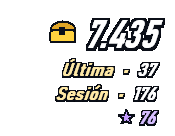
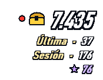
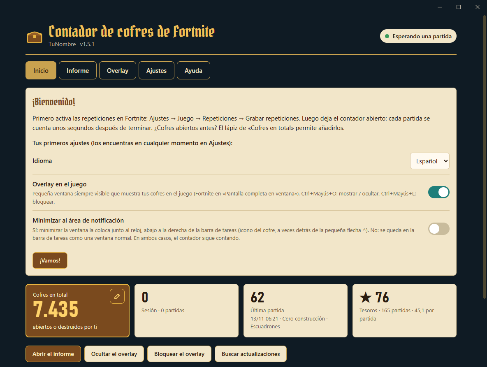
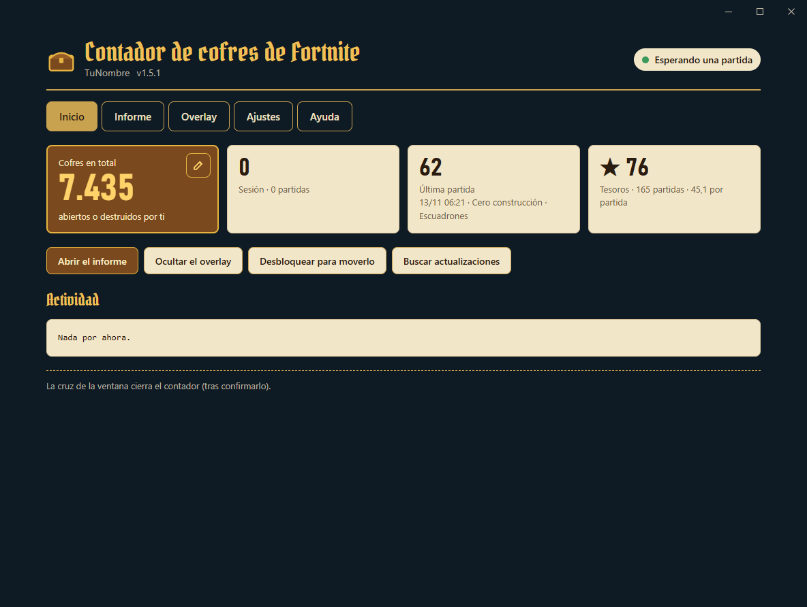
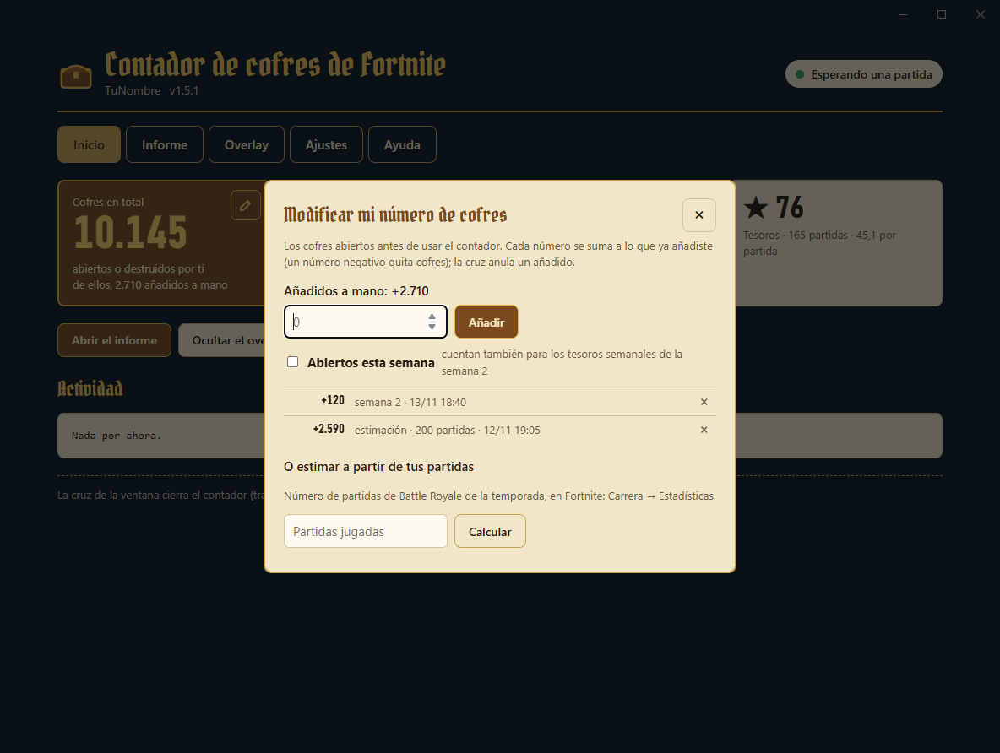
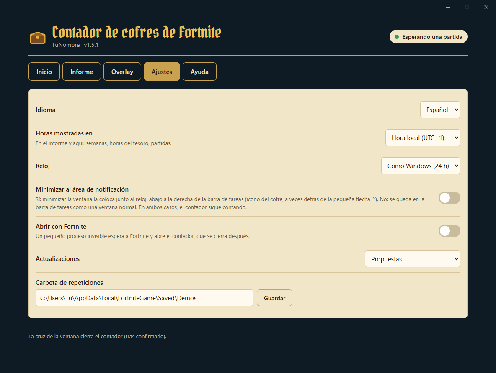
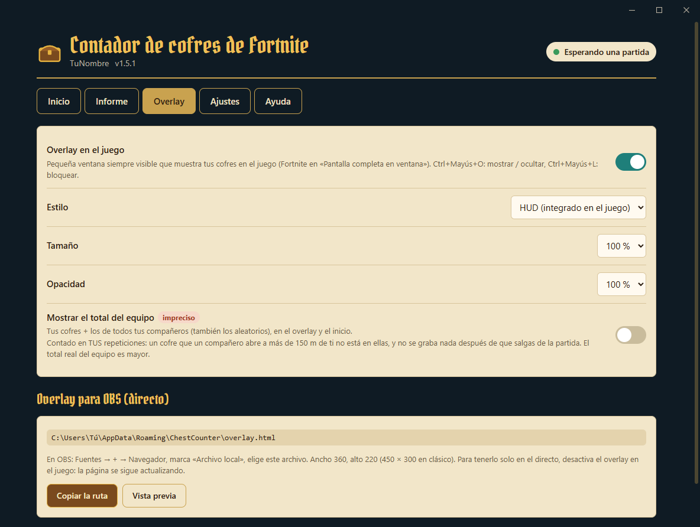
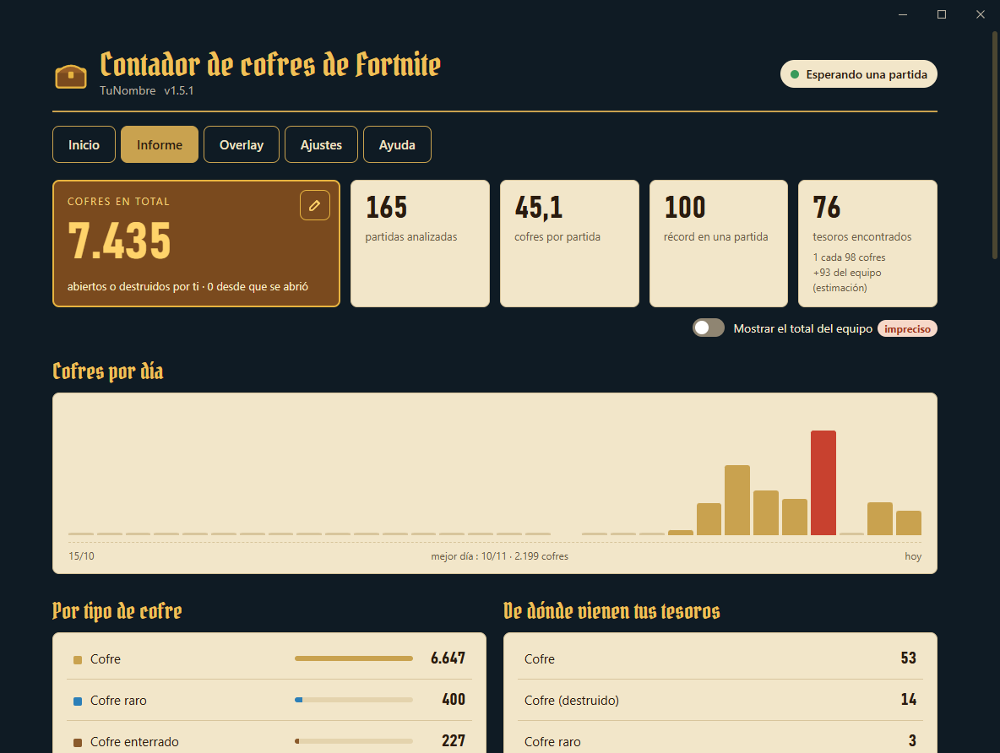
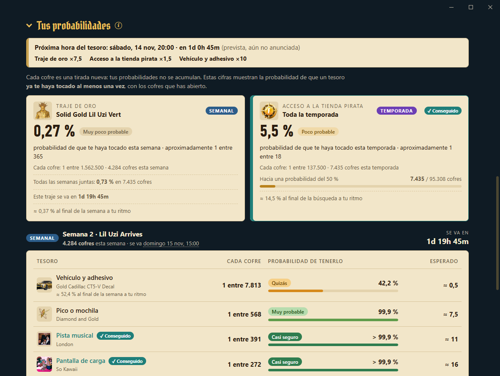

<div align="center">

[English](README.md) · [Français](README.fr.md) · **Español**


# Contador de cofres de Fortnite

[](../../releases/latest) [](../../releases)  [](LICENSE)

**Cuenta cada cofre que abres en Fortnite, partida tras partida, con un overlay integrado en el juego.**

&nbsp;&nbsp;&nbsp;&nbsp;

[**⬇ Descargar ChestCounter.exe**](../../releases/latest) · Windows 10 / 11 · gratis · sin instalación

</div>

---

Chest Counter lee las repeticiones que Fortnite guarda después de cada partida y lleva la cuenta de los cofres que has abierto, además de los **tesoros de la búsqueda del tesoro** conseguidos con tus cofres. Un overlay transparente muestra tus cifras encima del juego, como el resto del HUD, y la ventana del contador guarda todo tu historial, tus probabilidades de conseguir el traje de oro y tu colección de tesoros.

> Cuenta los cofres **que has abierto**. No muestra dónde están los cofres en el mapa.

## Cómo funciona (y por qué es seguro)

Fortnite puede grabar un **archivo de repetición** de cada partida en tu PC. Chest Counter lee esos archivos cuando termina la partida, y nada más.

- ✅ **Solo lee las repeticiones**: los archivos `.replay` que Fortnite escribe en `%LOCALAPPDATA%\FortniteGame\Saved\Demos`. Se abren en solo lectura y nunca se modifican.
- ✅ **Ninguna modificación del juego**: no se toca nada en la carpeta de instalación de Fortnite, no se añade ni cambia ningún archivo.
- ✅ **Ningún acceso a la memoria del juego**: la herramienta nunca lee, escribe ni inyecta nada en el proceso de Fortnite. No interactúa en absoluto con el juego en marcha.
- ✅ **No se envía ningún dato**: sin inicio de sesión, sin acceso a tu cuenta de Epic, sin telemetría. Solo se conecta a GitHub, para descargar: los datos de la búsqueda del tesoro (semanas, probabilidades, horas del tesoro, unos pocos kilobytes en cada inicio), las imágenes de la colección de tesoros (una sola vez) y, salvo que lo desactives, una nueva versión de la herramienta. No se envía nada.
- ✅ **Nada abierto a la red**: la ventana muestra una página que el contador sirve solo a tu PC (`127.0.0.1`, con una clave aleatoria).
- ✅ **Ligero**: funciona con prioridad baja (y en «modo de eficiencia» en Windows 11), duerme entre partidas, y el motor de visualización de la ventana se detiene cuando está en el área de notificación.

> [!IMPORTANT]
> **Las repeticiones deben estar activadas en Fortnite**: *Ajustes → Juego → Repeticiones → Grabar repeticiones: **Activado***. Sin repeticiones, la herramienta no tiene nada que leer.

Como Fortnite solo escribe la clave de descifrado de la repetición al terminar la partida, los cofres se cuentan **unos segundos después de cada partida**, no durante. Mientras juegas, un **punto rojo** junto al total del overlay indica que hay una partida en curso.

## Para empezar

1. Descarga **[`ChestCounter.exe`](../../releases/latest)**. Este único archivo es todo lo que necesitas.
2. Activa las repeticiones en Fortnite (ver arriba).
3. Ejecuta `ChestCounter.exe`.
   > Windows puede mostrar «Windows protegió tu PC» porque el exe no está firmado. Haz clic en *Más información → Ejecutar de todas formas*.
4. Se abre la ventana del contador. Ninguna pregunta: la tarjeta **Bienvenido** ajusta los tres puntos importantes (siguen en **Ajustes**), y las repeticiones que ya están en tu PC se cuentan enseguida.

<p align="center"></p>

5. Deja el contador abierto mientras juegas. Puedes minimizarlo: sigue contando (en la barra de tareas, o junto al reloj si elegiste el área de notificación). Unos segundos después de cada partida, se añaden sus cofres.

> [!TIP]
> Fortnite solo guarda un número limitado de repeticiones sin guardar y borra las más antiguas, y una partida jugada con el contador cerrado no se cuenta. Activa **Ajustes → Abrir con Fortnite** para no tener que pensar en ello.

## La ventana

Cinco pestañas: **Inicio**, **Informe**, **Overlay**, **Ajustes** y **Ayuda**. Arriba, tu cuenta y lo que está haciendo el contador (*Esperando una partida*, *Partida en curso*, *Contando los cofres…*).

- **Inicio**: tu total, tu sesión, tu última partida y tus tesoros, los botones del overlay y de las actualizaciones, y la actividad (cada partida contada, o por qué se ignoró una).
- **Informe**: todas tus estadísticas (ver más abajo).
- **Overlay**: el overlay en el juego y la página para OBS.
- **Ajustes**: idioma, horas (locales o UTC, reloj de 12 o 24 horas), área de notificación, abrir con Fortnite, actualizaciones, carpeta de repeticiones.
- **Ayuda**: cómo funciona, tu carpeta de datos, el registro de errores, un enlace para informar de un problema, y **Desinstalar**.

<p align="center"></p>

La cruz de la ventana pregunta antes de detener el contador (una partida jugada con el contador cerrado no se cuenta). Volver a abrir `ChestCounter.exe` trae la ventana al frente.

### Los cofres abiertos antes del contador

Haz clic en el **lápiz** de *Cofres en total* (Inicio o Informe) para añadir los cofres que abriste antes de usar el contador. Cada número que escribes se suma a lo que ya añadiste (un número negativo quita cofres), y la lista de abajo muestra cada añadido, con una **×** para anularlo. Marca **Abiertos esta semana** para cofres de la semana en curso: así cuentan también en las probabilidades de la semana. ¿No sabes cuántos? Indica el número de partidas que muestra Fortnite (*Carrera → Estadísticas*): el contador multiplica las partidas que no ha visto por tu media (una nueva estimación sustituye a la anterior).

<p align="center"></p>

### Ajustes

<p align="center"></p>

| Ajuste | Qué hace |
|---|---|
| Idioma | Francés, inglés o español. |
| Horas mostradas en | Hora local (por defecto) o UTC, para las semanas, las horas del tesoro y las partidas. |
| Reloj | Como Windows (por defecto), 12 horas o 24 horas. |
| Minimizar al área de notificación | Sí: minimizar la ventana la coloca junto al reloj, abajo a la derecha de la barra de tareas (icono del cofre, a veces detrás de la pequeña flecha ^). No (por defecto): se queda en la barra de tareas como una ventana normal. |
| Abrir con Fortnite | Ver más abajo. |
| Actualizaciones | Propuestas (por defecto), instaladas automáticamente o desactivadas. |
| Carpeta de repeticiones | Cámbiala solo si la has movido. |
| Cuenta (perfil) | Aparece cuando varias cuentas de Fortnite han grabado repeticiones en este PC. |

## Abrir con Fortnite

Con esta opción, un pequeño proceso invisible se inicia con Windows y comprueba cada pocos segundos si Fortnite está abierto. No lee nada del juego: solo mira la lista de programas abiertos. Cuando se inicia Fortnite, abre el contador minimizado (el juego conserva la pantalla). Cuando se cierra Fortnite, el contador cuenta tu última partida y se cierra 30 segundos después; **Mantener el contador abierto** en el Inicio (o volver a abrir `ChestCounter.exe`) lo mantiene abierto. Se puede desactivar en cualquier momento en **Ajustes**: el proceso invisible se detiene y se quita del inicio de Windows. Mientras la opción está activada, el proceso invisible sigue funcionando después de cerrar el contador, así que Windows no deja borrar ni mover `ChestCounter.exe`. Desactiva antes la opción, o usa **Ayuda → Desinstalar**.

## El overlay

Solo las cifras, contorneadas como las del juego, sin fondo: colócalo bajo el minimapa y se integra en el HUD.

- **En grande**: tu **total** de cofres, con el cofre dorado. Durante una partida, aparece un **punto rojo** a su lado (sus cofres se cuentan al final).
- **Última**: los cofres de tu última partida, que siguen visibles durante la siguiente.
- **Sesión**: los cofres desde que se abrió el contador.
- **★**: tus tesoros.

| Atajo | Qué hace |
|---|---|
| **Ctrl+Mayús+O** | Mostrar / ocultar el overlay. Funciona en cualquier sitio, incluso en el juego. |
| **Ctrl+Mayús+L** | Bloquear / desbloquear. **Bloqueado**: el ratón lo atraviesa (lo mejor en el juego). **Desbloqueado**: aparece un fondo, mantén el clic izquierdo para moverlo, clic derecho para ocultarlo. |

Para verlo encima del juego, pon Fortnite en **«Pantalla completa en ventana»** (*Ajustes → Vídeo → Modo ventana*): en pantalla completa exclusiva, Windows no puede mostrar nada encima del juego. La pestaña **Overlay** lo activa o desactiva y ajusta su estilo (HUD, o clásico: una tarjeta oscura con más detalles), su tamaño y su opacidad. **Mostrar el total del equipo** añade una línea con tus cofres + los de tus compañeros (desactivado por defecto, e impreciso: un cofre que un compañero abre a más de 150 m de ti no está en tus repeticiones).

<p align="center"></p>

**En directo (OBS).** El contador escribe continuamente `overlay.html` (carpeta de datos): las mismas cifras, con el estilo elegido, sobre fondo transparente, actualizadas cada 5 segundos. En OBS: *Fuentes → + → Navegador*, marca *Archivo local*, elige `%APPDATA%\ChestCounter\overlay.html`, ancho 360 × alto 220 (450 × 300 para el estilo clásico). **Copiar la ruta**, en la pestaña Overlay, la copia por ti. ¿Lo quieres solo en el directo, no en tu pantalla? Desactiva *Overlay en el juego*: la página para OBS se sigue actualizando.

## El informe

La pestaña **Informe** se actualiza sola después de cada partida: total, partidas, media, récord, tesoros (y **1 tesoro cada N cofres**), cofres por día, tipos de cofres y de dónde vienen tus tesoros. El interruptor bajo las cifras añade el **total del equipo** (desactivado por defecto). Las partes largas se pliegan: haz clic en su título para abrirlas.

<p align="center"></p>

- **Tus probabilidades** (abierta): la probabilidad de que cada tesoro ya te haya tocado al menos una vez, con una palabra que la resume (*Poco probable*, *Probable*, *Casi seguro*…). Un cofre solo da el tesoro de su semana, así que los tesoros **semanales** (traje de oro, vehículo y adhesivo, pico o mochila, pista musical, pantalla de carga) cuentan los cofres de esta semana, con su imagen y una cuenta atrás hasta que se van; el **acceso a la tienda pirata** y los artilugios cuentan toda la búsqueda. Las probabilidades son las publicadas por Epic Games. Durante una **hora del tesoro**, los cofres cuentan con su probabilidad aumentada, el banner muestra la actual o la próxima con una cuenta atrás, y las probabilidades de los tesoros potenciados cambian en directo (en naranja).
- **Lo consiguieron en tus partidas** (experimental): los accesos a la tienda pirata y trajes de oro que consiguieron otros jugadores cerca de ti.
- **Tu colección**: los tesoros de la temporada, semana a semana, para marcar lo que conseguiste. Un tesoro de un cofre dorado visto en tus repeticiones se marca solo.
- **Tesoros encontrados** y **Últimas partidas**: cada tesoro y cada partida, de 10 en 10.

<p align="center"></p>

El mismo informe también se escribe en `report.html` (carpeta de datos), para abrirlo en un navegador.

## Tesoros

- **★★ Cofre dorado (seguro).** Cuando un cofre da una recompensa de la búsqueda del tesoro (cosmético, pista musical, pantalla de carga, vehículo…), el servidor hace aparecer un cofre dorado que lleva el **identificador de la recompensa**. La herramienta lo lee en la repetición y nombra la recompensa.
- **★ Cada tesoro recibido (momento exacto).** Cada tesoro que recibes se registra con su hora exacta y el cofre del que viene; solo cuenta si ese cofre es **tuyo**. Cuando el objeto se puede identificar, se nombra; si no, aparece como **«Tesoro (tipo desconocido)»** (fuegos artificiales dorados, extractor portátil, localizadores, acelerador de extracción…), cuyo tipo exacto no está en la repetición.
- **Tesoros del equipo (estimación).** La búsqueda del tesoro comparte cada tesoro con todo el equipo: los que encuentran tus compañeros se pueden mostrar en *Tesoros encontrados* (interruptor), marcados con el icono de equipo. Se deducen de los tesoros que recibes sin haber abierto un cofre, y nunca cuentan en tus totales.
- Un tesoro que vino de algo que no es un cofre (caja de munición…) se marca con ⚑ y **fiabilidad baja**: lo más probable es que sea un error al leer la repetición.

El juego solo envía identificadores, no nombres: los nombres, las semanas, las probabilidades y las horas del tesoro vienen de [`content/content.json`](content/content.json), leído en GitHub en cada inicio, para que una nueva semana aparezca sin una nueva versión de la herramienta.

## Perfiles (varias cuentas en un mismo PC)

Las repeticiones guardadas en un PC suelen ser de su jugador: **ningún nombre que escribir**, la herramienta cuenta al jugador que grabó cada repetición. Si encuentra repeticiones de varias cuentas, cada cuenta tiene su propio perfil con sus propias estadísticas, y una lista junto al nombre, arriba de la ventana, pasa de una a otra. Después de una partida con otra cuenta, el contador sigue esa cuenta solo. Una partida jugada con otra cuenta se guarda en el perfil de esa cuenta, nunca se pierde.

## Actualizaciones

Al iniciarse, el contador comprueba en GitHub si hay una nueva versión. Si la hay, el Inicio muestra **sus novedades en tu idioma**, con **Instalar**: se descarga, se verifica y el contador se reinicia. Tu historial y tus ajustes se conservan. Después de la actualización, el Inicio muestra una vez lo que ha cambiado. **Buscar actualizaciones** vuelve a consultar GitHub en cualquier momento. En los ajustes puedes elegir *propuestas* (por defecto), *instaladas automáticamente* (solo entre dos partidas) o *desactivadas* (sin comprobación).

## Tus datos

Todo se guarda en `%APPDATA%\ChestCounter` (**Ayuda → Abrir la carpeta de datos**):

| Archivo | Contenido |
|---|---|
| `data.json` | Todo tu historial. **Haz una copia** si cambias de PC. |
| `config.json` | Tus ajustes, tu perfil, la posición del overlay. |
| `report.html` | El informe, para abrirlo en un navegador. |
| `overlay.html` | Overlay transparente para OBS. |
| `matches.csv` | Una línea por partida, para Excel o Google Sheets. |
| `content.json`, `images\` | Los datos y las imágenes de la búsqueda del tesoro descargados de GitHub. |
| `webview\` | Los datos del motor de visualización de la ventana. |
| `errors.log` | El detalle de las repeticiones ilegibles, para adjuntarlo a un informe de error. |

Para empezar de cero, borra esta carpeta (o conserva `data.json` para mantener tu historial). Si usabas la versión anterior (ChestTracker), tu carpeta `%APPDATA%\ChestTracker` se recupera automáticamente.

## Preguntas frecuentes

**No se cuenta nada.** Comprueba que las repeticiones están activadas en Fortnite y que el contador está abierto cuando termina la partida. La parte de arriba de la ventana indica si falta la carpeta de repeticiones, y la actividad del Inicio dice por qué se ignoró una partida.

**¿Se cuentan las cajas de munición?** No. Las cajas de munición, de comida y los cañones de botín no forman parte del total de cofres. Los cofres que **destruyes** en lugar de abrirlos sí se cuentan. Un cofre que se rellena durante la partida y que vuelves a abrir cuenta una vez más; volver cerca de un cofre ya abierto (cofre enterrado desenterrado, cofre de sprite) no lo cuenta dos veces.

**¿Qué modos se cuentan?** Solo el **Battle Royale en el mapa de la temporada** (con construcción y cero construcción, de solo a escuadrones), donde se juega la búsqueda del tesoro de los cofres. No se cuentan: clasificatoria, OG, Reload, Blitz y otros modos temporales, islas de Creativo y UEFN, LEGO, Festival, partidas privadas. El contador lee el mapa y el modo de cada repetición; una partida ignorada dice por qué en la actividad.

**¿Una partida con ⚠ en el informe?** Fortnite no grabó lo que destruyó tu vehículo en esa repetición: se vio botín de cofres a lo largo de tu trayecto sin ningún cofre grabado, así que esos cofres no se pueden contar. El ⚠ explica qué hacer.

**Fortnite se cerró en mitad de una partida.** Su repetición está incompleta (Fortnite nunca escribió la clave de descifrado): esa partida no se puede contar, y la herramienta la muestra como «repetición incompleta».

**«No se puede leer esta repetición».** Una actualización de Fortnite puede cambiar el formato de las repeticiones; entonces hay que actualizar el lector. Las partidas ya contadas se conservan. [Abre una issue](../../issues) con `errors.log` adjunto (**Ayuda → Abrir el registro de errores**).

**No puedo borrar `ChestCounter.exe` («el archivo está abierto en otro programa»): ¿por qué?** Con **Abrir con Fortnite** activado, un pequeño proceso invisible usa el exe todo el tiempo, incluso con el contador cerrado. Dos soluciones:
- **Ayuda → Desinstalar ChestCounter**: desactiva la opción, cierra el contador y borra el exe. Eliges si conservar tu historial y tus ajustes (`%APPDATA%\ChestCounter`, útil si lo vuelves a instalar más adelante) o borrarlo todo.
- O desactiva **Ajustes → Abrir con Fortnite**, cierra el contador y borra `ChestCounter.exe` tú mismo.

**¿Dónde está la ventana?** Con **Ajustes → Minimizar al área de notificación** activado, el contador minimizado está junto al reloj, abajo a la derecha de la barra de tareas (icono del cofre, a veces detrás de la pequeña flecha ^); un clic encima lo vuelve a abrir. Volver a abrir `ChestCounter.exe` también lo trae de vuelta.

**La ventana se queda en blanco o se abre en mi navegador.** La ventana usa Microsoft Edge WebView2, integrado en Windows 11 e instalado en casi todos los Windows 10. Sin él, el contador abre la misma página en tu navegador. Puedes instalarlo desde la web de [Microsoft](https://developer.microsoft.com/microsoft-edge/webview2/) (*Evergreen Bootstrapper*).

**¿Ya está abierto?** Solo puede funcionar un contador a la vez: volver a abrirlo trae la ventana abierta al frente.

**¿Se puede contar una partida dos veces?** No, aunque cambies el nombre de la repetición o la guardes.

## Opciones de línea de comandos

```
ChestCounter.exe --lang <fr|en|es>   cambiar el idioma
ChestCounter.exe --demos <carpeta>   otra carpeta de repeticiones
ChestCounter.exe --data <carpeta>    otra carpeta de datos
ChestCounter.exe --once              analiza las repeticiones terminadas y sale (escribe en la terminal)
ChestCounter.exe --reset-config      olvida los ajustes (tu historial se conserva)
ChestCounter.exe --overlay-preview <archivo.png>   guarda vistas previas del overlay y sale
```

## Compilarlo uno mismo

Instala el [SDK de .NET 10](https://dotnet.microsoft.com/download/dotnet/10.0) (Windows x64) y haz doble clic en **`build.bat`**: el exe se escribe en `dist\ChestCounter.exe`. El workflow de GitHub Actions compila el exe en cada push y lo adjunta a una release cuando se sube un tag `v*`, con el texto de [`RELEASE_NOTES.md`](RELEASE_NOTES.md) (también se muestra en el contador después de una actualización).

## Licencia y créditos

[MIT](LICENSE). La lectura de las repeticiones se basa en [FortniteReplayDecompressor](https://github.com/Shiqan/FortniteReplayDecompressor) de Shiqan (MIT), ligeramente modificado: ver [`lib/PATCHES.md`](lib/PATCHES.md). La ventana usa [Microsoft Edge WebView2](https://developer.microsoft.com/microsoft-edge/webview2/). Los títulos usan la fuente [Pirata One](https://fonts.google.com/specimen/Pirata+One) (SIL Open Font License, [`src/ChestCounter/Assets/PirataOne-OFL.txt`](src/ChestCounter/Assets/PirataOne-OFL.txt)). Imágenes y horarios de los tesoros: [fortnite.bot](https://fortnite.bot). Gracias a [koiseka](https://github.com/koiseka) por sus correcciones del recuento ([#6](../../pull/6)).

Este proyecto no está afiliado, respaldado ni patrocinado por Epic Games. Fortnite es una marca registrada de Epic Games, Inc.
