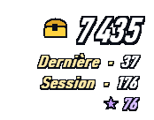
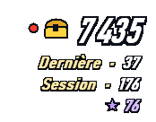
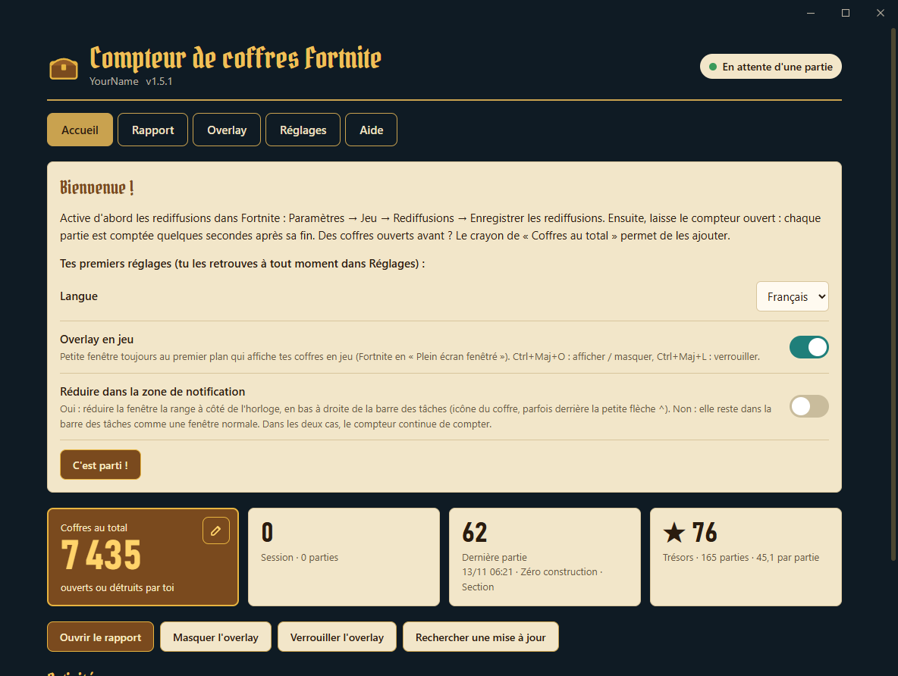
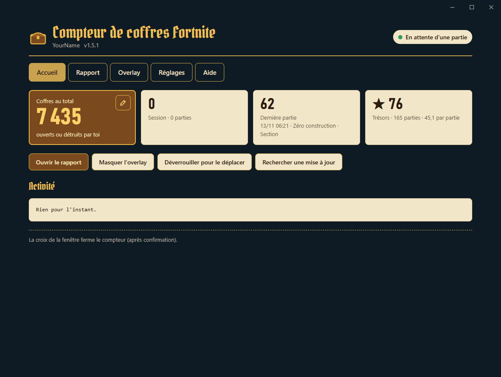
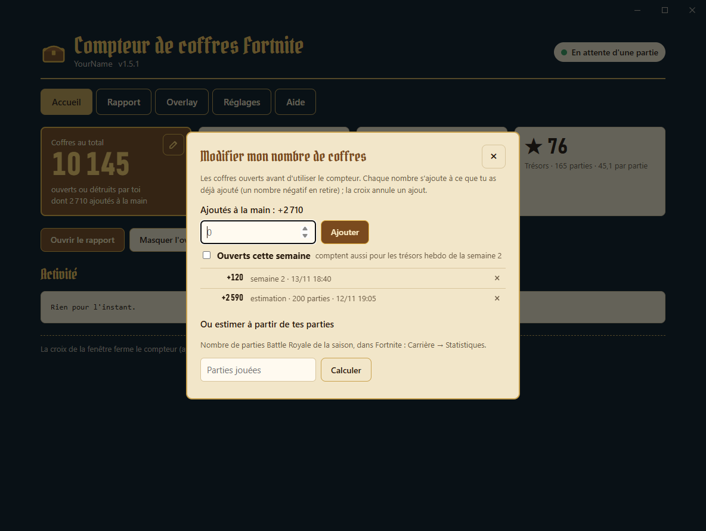
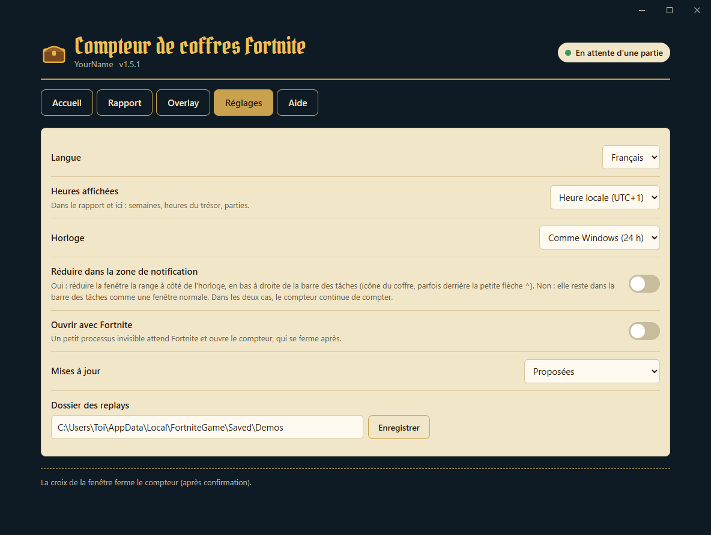
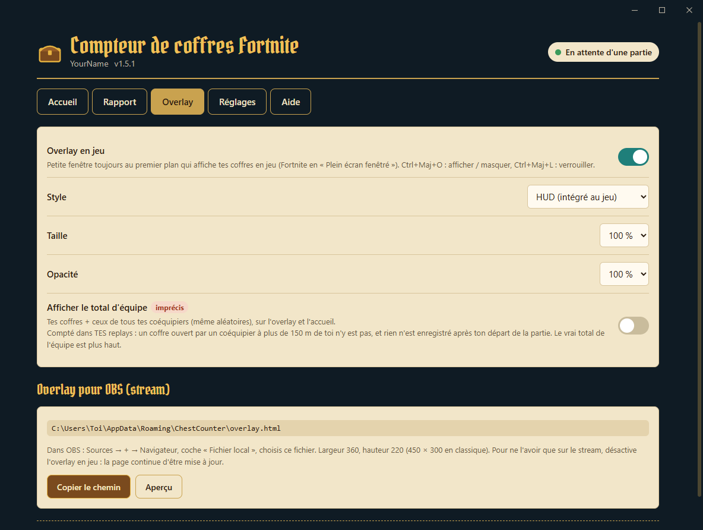
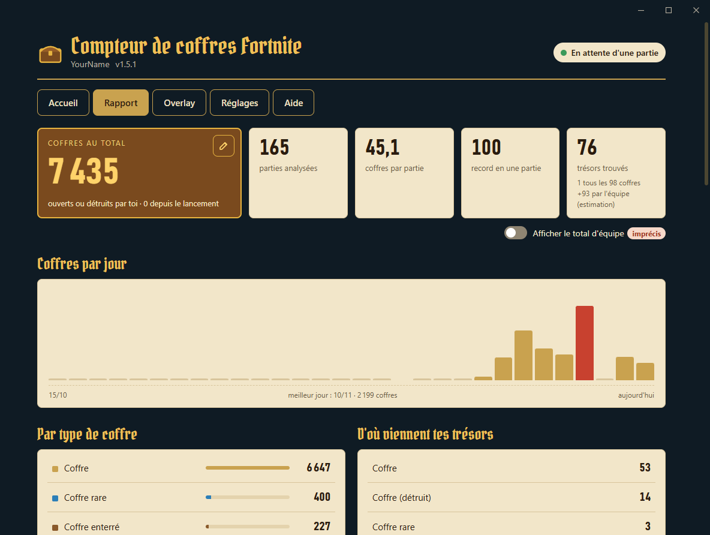
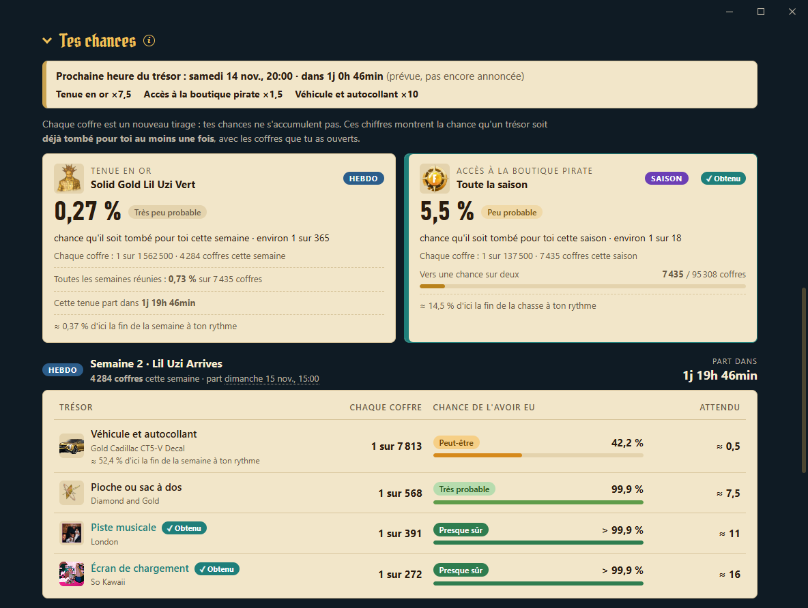

<div align="center">

[English](README.md) · **Français** · [Español](README.es.md)


# Compteur de coffres Fortnite

[](../../releases/latest) [](../../releases)  [](LICENSE)

**Compte chaque coffre que tu ouvres dans Fortnite, partie après partie, avec un overlay qui se fond dans le jeu.**

&nbsp;&nbsp;&nbsp;&nbsp;

[**⬇ Télécharger ChestCounter.exe**](../../releases/latest) · Windows 10 / 11 · gratuit · sans installation

</div>

---

Le compteur de coffres lit les replays (« rediffusions ») que Fortnite enregistre après chaque partie et tient le compte des coffres que tu as ouverts, ainsi que des **trésors de la chasse au trésor** sortis de tes coffres. Un overlay transparent affiche tes chiffres par-dessus le jeu, comme le reste du HUD, et la fenêtre du compteur garde tout ton historique, tes chances d'obtenir la tenue en or et ta collection de trésors.

> Il compte les coffres **que tu as ouverts**. Il n'indique pas où se trouvent les coffres sur la carte.

## Comment ça marche (et pourquoi c'est sûr)

Fortnite peut enregistrer un **fichier replay** de chaque partie sur ton PC. Le compteur lit ces fichiers une fois la partie terminée, et rien d'autre.

- ✅ **Lit uniquement les replays** : les fichiers `.replay` que Fortnite écrit dans `%LOCALAPPDATA%\FortniteGame\Saved\Demos`. Ils sont ouverts en lecture seule, jamais modifiés.
- ✅ **Aucune modification du jeu** : rien n'est touché dans le dossier d'installation de Fortnite, aucun fichier n'est ajouté ni changé.
- ✅ **Aucun accès à la mémoire du jeu** : l'outil ne lit, n'écrit et n'injecte jamais rien dans le processus Fortnite. Il n'interagit pas du tout avec le jeu en cours.
- ✅ **Aucune donnée envoyée** : pas de connexion, pas d'accès à ton compte Epic, pas de télémétrie. Il ne se connecte qu'à GitHub, pour télécharger : les données de la chasse au trésor (semaines, cotes, heures du trésor, quelques kilo-octets à chaque démarrage), les images de la collection de trésors (une seule fois) et, sauf si tu le désactives, une nouvelle version de l'outil. Rien n'est envoyé.
- ✅ **Rien d'ouvert sur le réseau** : la fenêtre affiche une page que le compteur sert à ton PC uniquement (`127.0.0.1`, avec une clé aléatoire).
- ✅ **Léger** : tourne en priorité basse (et en « mode efficacité » sur Windows 11), dort entre les parties, et le moteur d'affichage de la fenêtre est arrêté quand elle est dans la zone de notification.

> [!IMPORTANT]
> **Les rediffusions doivent être activées dans Fortnite** : *Paramètres → Jeu → Rediffusions → Enregistrer les rediffusions : **Activé***. Sans replays, l'outil n'a rien à lire.

Comme Fortnite n'écrit la clé de déchiffrement du replay qu'à la fin de la partie, les coffres sont comptés **quelques secondes après chaque partie**, pas pendant. Pendant que tu joues, un **point rouge** à côté du total de l'overlay indique qu'une partie est en cours.

## Démarrer

1. Télécharge **[`ChestCounter.exe`](../../releases/latest)**. Ce seul fichier suffit.
2. Active les rediffusions dans Fortnite (voir ci-dessus).
3. Lance `ChestCounter.exe`.
   > Windows peut afficher « Windows a protégé votre ordinateur » car l'exe n'est pas signé. Clique sur *Informations complémentaires → Exécuter quand même*.
4. La fenêtre du compteur s'ouvre. Aucune question : la carte **Bienvenue** règle les trois points importants (ils restent dans **Réglages**), et les replays déjà présents sur ton PC sont comptés tout de suite.

<p align="center"></p>

5. Laisse le compteur ouvert pendant que tu joues. Tu peux le réduire : il continue de compter (dans la barre des tâches, ou à côté de l'horloge si tu as choisi la zone de notification). Quelques secondes après chaque partie, ses coffres sont ajoutés.

> [!TIP]
> Fortnite ne garde qu'un nombre limité de replays non sauvegardés et supprime les plus anciens, et une partie jouée compteur fermé n'est pas comptée. Active **Réglages → Ouvrir avec Fortnite** pour ne plus y penser.

## La fenêtre

Cinq onglets : **Accueil**, **Rapport**, **Overlay**, **Réglages** et **Aide**. En haut, ton compte et ce que fait le compteur (*En attente d'une partie*, *Partie en cours*, *Comptage des coffres…*).

- **Accueil** : ton total, ta session, ta dernière partie et tes trésors, les boutons de l'overlay et des mises à jour, et l'activité (chaque partie comptée, ou pourquoi une partie a été ignorée).
- **Rapport** : toutes tes statistiques (voir plus bas).
- **Overlay** : l'overlay en jeu et la page pour OBS.
- **Réglages** : langue, heures (locales ou UTC, sur 12 ou 24 heures), zone de notification, ouverture avec Fortnite, mises à jour, dossier des replays.
- **Aide** : le fonctionnement, ton dossier de données, le journal d'erreurs, un lien pour signaler un problème, et **Désinstaller**.

<p align="center"></p>

La croix de la fenêtre demande avant d'arrêter le compteur (une partie jouée compteur fermé n'est pas comptée). Relancer `ChestCounter.exe` ramène la fenêtre au premier plan.

### Les coffres ouverts avant le compteur

Clique sur le **crayon** de *Coffres au total* (Accueil ou Rapport) pour ajouter les coffres que tu as ouverts avant d'utiliser le compteur. Chaque nombre tapé s'ajoute à ce que tu as déjà ajouté (un nombre négatif en retire), et la liste en dessous montre chaque ajout, avec une **×** pour l'annuler. Coche **Ouverts cette semaine** pour des coffres de la semaine en cours : ils comptent alors aussi dans les chances de la semaine. Tu ne sais pas combien ? Indique le nombre de parties affiché dans Fortnite (*Carrière → Statistiques*) : le compteur multiplie les parties qu'il n'a pas vues par ta moyenne (une nouvelle estimation remplace la précédente).

<p align="center"></p>

### Réglages

<p align="center"></p>

| Réglage | Effet |
|---|---|
| Langue | Français, anglais ou espagnol. |
| Heures affichées | Heure locale (par défaut) ou UTC, pour les semaines, les heures du trésor et les parties. |
| Horloge | Comme Windows (par défaut), 12 heures ou 24 heures. |
| Réduire dans la zone de notification | Oui : réduire la fenêtre la range à côté de l'horloge, en bas à droite de la barre des tâches (icône du coffre, parfois derrière la petite flèche ^). Non (par défaut) : elle reste dans la barre des tâches comme une fenêtre normale. |
| Ouvrir avec Fortnite | Voir plus bas. |
| Mises à jour | Proposées (par défaut), installées automatiquement ou désactivées. |
| Dossier des replays | À changer seulement si tu l'as déplacé. |
| Compte (profil) | Affiché quand plusieurs comptes Fortnite ont enregistré des replays sur ce PC. |

## Ouvrir avec Fortnite

Avec cette option, un tout petit processus invisible démarre avec Windows et regarde toutes les quelques secondes si Fortnite est lancé. Il ne lit rien du jeu : il regarde seulement la liste des programmes ouverts. Quand Fortnite démarre, il ouvre le compteur réduit (le jeu garde l'écran). Quand Fortnite se ferme, le compteur compte ta dernière partie, puis se ferme 30 secondes plus tard ; **Garder le compteur ouvert** dans l'Accueil (ou relancer `ChestCounter.exe`) le garde ouvert. Désactivable à tout moment dans **Réglages** : le processus invisible s'arrête et est retiré du démarrage de Windows. Tant que l'option est active, le processus invisible continue de tourner après la fermeture du compteur : Windows refuse alors de supprimer ou déplacer `ChestCounter.exe`. Désactive d'abord l'option, ou utilise **Aide → Désinstaller**.

## L'overlay

Juste les chiffres, contourés comme ceux du jeu, sans fond : place-le sous la minicarte et il se fond dans le HUD.

- **En grand** : ton **total** de coffres, avec le coffre doré. Pendant une partie, un **point rouge** s'affiche à côté (ses coffres sont comptés à la fin).
- **Dernière** : les coffres de ta dernière partie, toujours affichés pendant la suivante.
- **Session** : les coffres depuis le lancement du compteur.
- **★** : tes trésors.

| Raccourci | Effet |
|---|---|
| **Ctrl+Maj+O** | Afficher / masquer l'overlay. Marche partout, même en jeu. |
| **Ctrl+Maj+L** | Verrouiller / déverrouiller. **Verrouillé** : la souris passe au travers (idéal en jeu). **Déverrouillé** : un fond apparaît, maintiens le clic gauche pour le déplacer, clic droit pour le masquer. |

Pour le voir par-dessus le jeu, mets Fortnite en **Plein écran fenêtré** (*Paramètres → Vidéo → Mode de fenêtre*) : en plein écran exclusif, Windows ne peut rien afficher par-dessus le jeu. L'onglet **Overlay** l'active ou le désactive et règle son style (HUD, ou classique : une carte sombre avec plus de détails), sa taille et son opacité. **Afficher le total d'équipe** ajoute une ligne avec tes coffres + ceux de tes coéquipiers (désactivé par défaut, et imprécis : un coffre ouvert par un coéquipier à plus de 150 m de toi n'est pas dans tes replays).

<p align="center"></p>

**En stream (OBS).** Le compteur écrit en continu `overlay.html` (dossier des données) : les mêmes chiffres, au style choisi, sur fond transparent, rafraîchis toutes les 5 secondes. Dans OBS : *Sources → + → Navigateur*, coche *Fichier local*, choisis `%APPDATA%\ChestCounter\overlay.html`, largeur 360 × hauteur 220 (450 × 300 pour le style classique). **Copier le chemin**, dans l'onglet Overlay, le copie pour toi. Tu le veux seulement sur le stream, pas sur ton écran ? Désactive *Overlay en jeu* : la page pour OBS continue d'être mise à jour.

## Le rapport

L'onglet **Rapport** se met à jour tout seul après chaque partie : total, parties, moyenne, record, trésors (et **1 trésor tous les N coffres**), coffres par jour, types de coffres et provenance de tes trésors. L'interrupteur sous les chiffres ajoute le **total d'équipe** (désactivé par défaut). Les longues parties se replient : clique sur leur titre pour les ouvrir.

<p align="center"></p>

- **Tes chances** (ouverte) : la probabilité que chaque trésor soit déjà tombé pour toi au moins une fois, avec un mot pour la dire (*Peu probable*, *Probable*, *Presque sûr*…). Un coffre ne donne que le trésor de sa semaine : les trésors **hebdo** (tenue en or, véhicule et autocollant, pioche ou sac à dos, piste musicale, écran de chargement) comptent donc les coffres de la semaine, avec leur image et un compte à rebours jusqu'à leur départ ; l'**accès à la boutique pirate** et les gizmos comptent toute la chasse. Les cotes sont celles publiées par Epic Games. Pendant une **heure du trésor**, les coffres comptent avec leurs chances augmentées, le bandeau affiche celle en cours ou la prochaine avec un compte à rebours, et les cotes des trésors boostés changent en direct (en orange).
- **Ils l'ont eu dans tes parties** (expérimental) : les accès à la boutique pirate et tenues en or obtenus par d'autres joueurs près de toi.
- **Ta collection** : les trésors de la saison, semaine par semaine, à cocher. Un trésor sorti d'un coffre doré vu dans tes replays est coché tout seul.
- **Trésors trouvés** et **Dernières parties** : chaque trésor et chaque partie, 10 par 10.

<p align="center"></p>

Le même rapport est aussi écrit dans `report.html` (dossier des données), à ouvrir dans un navigateur.

## Trésors

- **★★ Coffre doré (certain).** Quand un coffre donne une récompense de la chasse au trésor (cosmétique, piste musicale, écran de chargement, véhicule…), le serveur fait apparaître un coffre doré qui porte l'**identifiant de la récompense**. L'outil le lit dans le replay et nomme la récompense.
- **★ Chaque trésor reçu (moment exact).** Chaque trésor que tu reçois est enregistré avec son heure exacte et le coffre d'où il vient ; il ne compte que si ce coffre est **le tien**. Quand l'objet est identifiable, il est nommé ; sinon il apparaît comme **« Trésor (type inconnu) »** (feu d'artifice doré, extracteur portable, localisateurs, accélérateur d'extraction…), dont le type exact n'est pas dans le replay.
- **Trésors de l'équipe (estimation).** La chasse au trésor partage chaque trésor avec toute l'équipe : ceux que trouvent tes coéquipiers peuvent être affichés dans *Trésors trouvés* (interrupteur), marqués de l'icône équipe. Ils sont déduits des trésors que tu reçois sans avoir ouvert de coffre, et ne comptent jamais dans tes totaux.
- Un trésor venu d'autre chose qu'un coffre (caisse de munitions…) est signalé par ⚑ et une **fiabilité faible** : c'est très probablement une erreur de lecture du replay.

Le jeu n'envoie que des identifiants, pas de noms : les noms, les semaines, les cotes et les heures du trésor viennent de [`content/content.json`](content/content.json), lu sur GitHub à chaque démarrage, pour qu'une nouvelle semaine apparaisse sans nouvelle version de l'outil.

## Profils (plusieurs comptes sur un même PC)

Les replays enregistrés sur un PC sont normalement ceux de son joueur : **aucun pseudo à saisir**, l'outil compte le joueur qui a enregistré chaque replay. S'il trouve des replays de plusieurs comptes, chaque compte a son propre profil avec ses propres statistiques, et une liste à côté du nom, en haut de la fenêtre, passe de l'un à l'autre. Après une partie sur un autre compte, le compteur suit ce compte tout seul. Une partie jouée sur un autre compte est enregistrée dans le profil de ce compte, jamais perdue.

## Mises à jour

Au démarrage, le compteur vérifie sur GitHub s'il existe une nouvelle version. Si oui, l'accueil affiche **ses nouveautés dans ta langue**, avec **Installer** : elle est téléchargée, vérifiée, et le compteur redémarre. Ton historique et tes réglages sont conservés. Après la mise à jour, l'accueil affiche une fois ce qui a changé. **Rechercher une mise à jour** interroge GitHub à tout moment. Dans les réglages, tu peux choisir *proposées* (par défaut), *installées automatiquement* (seulement entre deux parties) ou *désactivées* (aucune vérification).

## Tes données

Tout est stocké dans `%APPDATA%\ChestCounter` (**Aide → Ouvrir le dossier des données**) :

| Fichier | Contenu |
|---|---|
| `data.json` | Tout ton historique. **Sauvegarde-le** si tu changes de PC. |
| `config.json` | Tes réglages, ton profil, la position de l'overlay. |
| `report.html` | Le rapport, à ouvrir dans un navigateur. |
| `overlay.html` | Overlay transparent pour OBS. |
| `matches.csv` | Une ligne par partie, pour Excel ou Google Sheets. |
| `content.json`, `images\` | Les données et images de la chasse au trésor téléchargées depuis GitHub. |
| `webview\` | Les données du moteur d'affichage de la fenêtre. |
| `errors.log` | Le détail des replays illisibles, à joindre à un signalement. |

Pour tout recommencer, supprime ce dossier (ou garde `data.json` pour conserver ton historique). Si tu utilisais l'ancienne version (ChestTracker), ton dossier `%APPDATA%\ChestTracker` est repris automatiquement.

## FAQ

**Rien n'est compté.** Vérifie que les rediffusions sont activées dans Fortnite et que le compteur tourne quand la partie se termine. Le haut de la fenêtre indique si le dossier des replays est introuvable, et l'activité de l'accueil dit pourquoi une partie a été ignorée.

**Les caisses de munitions sont-elles comptées ?** Non. Les caisses de munitions, de nourriture et les canons à butin ne font pas partie du total de coffres. Les coffres que tu **détruis** au lieu de les ouvrir sont comptés. Un coffre rempli à nouveau pendant la partie et que tu rouvres compte une fois de plus ; revenir près d'un coffre déjà ouvert (coffre enterré déterré, coffre de sprite) ne le compte pas deux fois.

**Quels modes sont comptés ?** Seulement le **Battle Royale sur la carte de la saison** (construction et zéro construction, du solo à l'escouade), là où se déroule la chasse au trésor des coffres. Pas comptés : le classé, OG, Reload, Blitz et les autres modes temporaires, les îles Créatif et UEFN, LEGO, Festival, les parties privées. Le compteur lit la carte et le mode de chaque replay ; une partie ignorée dit pourquoi dans l'activité.

**Une partie avec ⚠ dans le rapport ?** Fortnite n'a pas enregistré ce que ton véhicule a détruit dans ce replay : du butin de coffres a été vu le long de ton trajet sans aucun coffre enregistré, ces coffres ne peuvent donc pas être comptés. Le ⚠ explique quoi faire.

**Fortnite s'est fermé en pleine partie.** Son replay est incomplet (Fortnite n'a jamais écrit la clé de déchiffrement) : cette partie ne peut pas être comptée, et l'outil l'affiche comme « replay incomplet ».

**« Impossible de lire ce replay ».** Une mise à jour de Fortnite peut changer le format des replays ; le lecteur doit alors être mis à jour. Les parties déjà comptées sont conservées. [Ouvre une issue](../../issues) avec `errors.log` en pièce jointe (**Aide → Ouvrir le journal d'erreurs**).

**Je n'arrive pas à supprimer `ChestCounter.exe` (« le fichier est ouvert dans un autre programme ») : pourquoi ?** Avec **Ouvrir avec Fortnite** activé, un petit processus invisible utilise l'exe en permanence, même compteur fermé. Deux solutions :
- **Aide → Désinstaller ChestCounter** : désactive l'option, ferme le compteur et supprime l'exe. Tu choisis de garder ton historique et tes réglages (`%APPDATA%\ChestCounter`, pratique si tu le réinstalles plus tard) ou de tout supprimer.
- Ou désactive **Réglages → Ouvrir avec Fortnite**, ferme le compteur, puis supprime `ChestCounter.exe` toi-même.

**Où est passée la fenêtre ?** Avec **Réglages → Réduire dans la zone de notification** activé, le compteur réduit est à côté de l'horloge, en bas à droite de la barre des tâches (icône du coffre, parfois derrière la petite flèche ^) ; un clic dessus le rouvre. Relancer `ChestCounter.exe` le ramène aussi.

**La fenêtre reste vide ou s'ouvre dans mon navigateur.** La fenêtre utilise Microsoft Edge WebView2, intégré à Windows 11 et installé sur presque tous les Windows 10. Sans lui, le compteur ouvre la même page dans ton navigateur. Tu peux l'installer depuis le site de [Microsoft](https://developer.microsoft.com/microsoft-edge/webview2/) (*Evergreen Bootstrapper*).

**Déjà ouvert ?** Un seul compteur peut tourner à la fois : le relancer ramène la fenêtre ouverte au premier plan.

**Une partie peut-elle être comptée deux fois ?** Non, même si tu renommes ou sauvegardes le replay.

## Options en ligne de commande

```
ChestCounter.exe --lang <fr|en|es>   changer la langue
ChestCounter.exe --demos <dossier>   un autre dossier de replays
ChestCounter.exe --data <dossier>    un autre dossier de données
ChestCounter.exe --once              analyse les replays terminés puis quitte (écrit dans le terminal)
ChestCounter.exe --reset-config      oublie les réglages (ton historique est conservé)
ChestCounter.exe --overlay-preview <fichier.png>   enregistre des aperçus de l'overlay puis quitte
```

## Le compiler soi-même

Installe le [SDK .NET 10](https://dotnet.microsoft.com/download/dotnet/10.0) (Windows x64), puis double-clique sur **`build.bat`** : l'exe est écrit dans `dist\ChestCounter.exe`. Le workflow GitHub Actions compile l'exe à chaque push et le joint à une release quand un tag `v*` est poussé, avec le texte de [`RELEASE_NOTES.md`](RELEASE_NOTES.md) (aussi affiché dans le compteur après une mise à jour).

## Licence et crédits

[MIT](LICENSE). La lecture des replays s'appuie sur [FortniteReplayDecompressor](https://github.com/Shiqan/FortniteReplayDecompressor) de Shiqan (MIT), légèrement modifié : voir [`lib/PATCHES.md`](lib/PATCHES.md). La fenêtre utilise [Microsoft Edge WebView2](https://developer.microsoft.com/microsoft-edge/webview2/). Les titres utilisent la police [Pirata One](https://fonts.google.com/specimen/Pirata+One) (SIL Open Font License, [`src/ChestCounter/Assets/PirataOne-OFL.txt`](src/ChestCounter/Assets/PirataOne-OFL.txt)). Images et horaires des trésors : [fortnite.bot](https://fortnite.bot). Merci à [koiseka](https://github.com/koiseka) pour ses corrections du comptage ([#6](../../pull/6)).

Ce projet n'est ni affilié, ni approuvé, ni sponsorisé par Epic Games. Fortnite est une marque déposée d'Epic Games, Inc.
